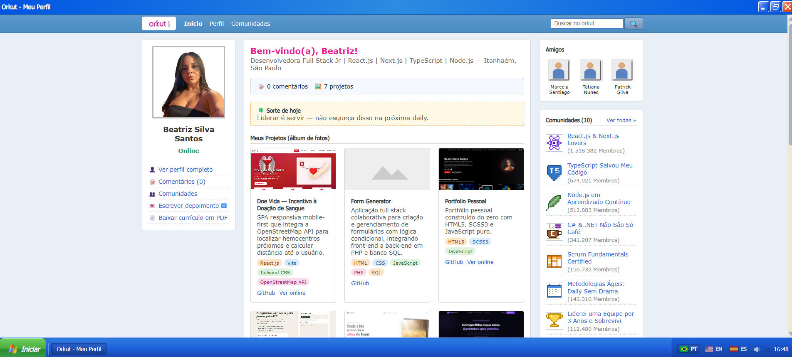
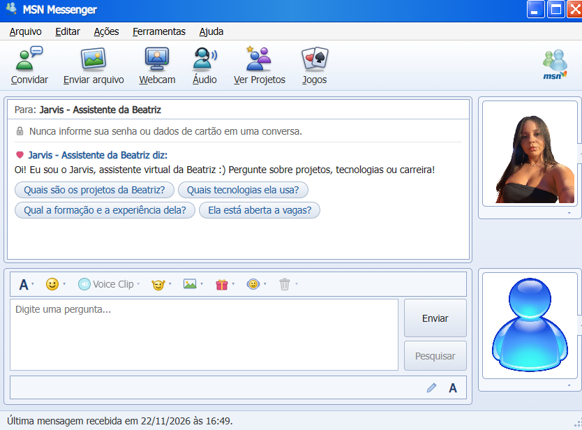
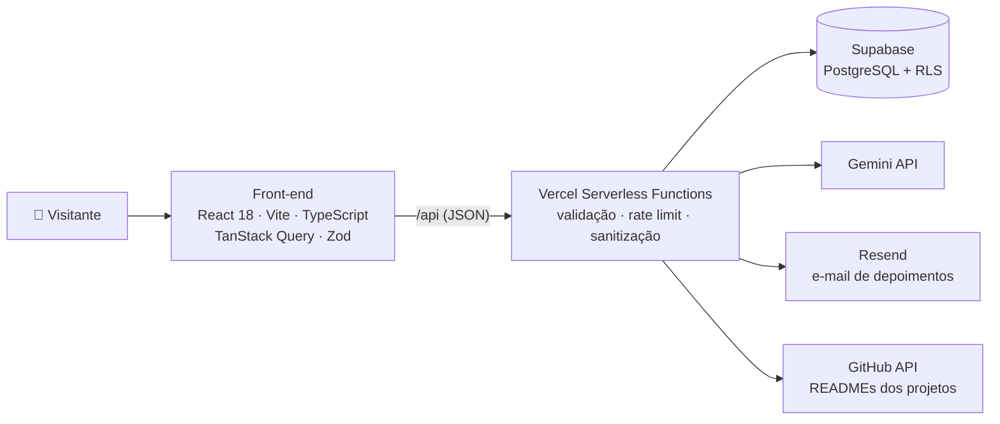
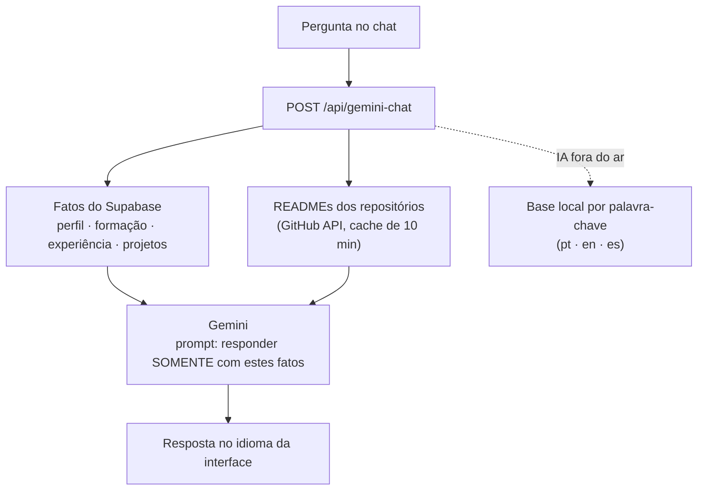

<div align="center">

# 🖥️ Portfólio Retrô

**Um computador dos anos 2000 que, por dentro, é uma aplicação full stack moderna.**
Windows XP · Orkut · MSN Messenger, com dados reais de um banco, um assistente de IA que não inventa e interface em 3 idiomas.


**[🔗 Ver ao vivo](https://beatriz-portfolio-retro.vercel.app/)** · **[💼 LinkedIn](https://www.linkedin.com/in/beatrizsilvasantos-dev)** · **[🐙 GitHub](https://github.com/BeatrizS97)**

</div>

---

## 👀 Demonstração

> Não quer rodar nada? Abra o link acima, dê dois cliques no **Orkut** para ver o perfil e no **MSN Messenger** para conversar com o Jarvis.

| Área de trabalho | Orkut (perfil e projetos) | MSN (Jarvis, a IA) |
| --- | --- | --- |
|  |  |  |


---

## 🎯 Contexto e problema

Portfólios de desenvolvedor júnior costumam parecer iguais: uma página com cards de projetos que o recrutador percorre em segundos. Eu queria resolver dois problemas ao mesmo tempo:

1. **Ser lembrada.** A interface é uma homenagem aos anos 2000 (boot do Windows XP, janelas arrastáveis, Orkut, MSN) e vira uma conversa: "como ela fez isso?".
2. **Provar, e não só dizer, que sei construir um produto completo.** Por trás do visual existe um front-end tipado, uma API serverless, banco com regras de segurança, integração com IA e e-mail, testes e acessibilidade.

Cada parte do cenário nostálgico cumpre uma função real do portfólio:

| No cenário | Na prática |
| --- | --- |
| 👥 **Orkut** | Perfil, projetos em formato de "álbum", formação, certificações, experiência, comunidades (minhas habilidades), recados públicos e depoimentos |
| 💬 **MSN Messenger** | Chat com o **Jarvis**, assistente de IA que responde sobre mim usando só dados reais |
| 🪟 **Windows XP** | Gerenciador de janelas, barra de tarefas, menu Iniciar (com download do currículo em PDF) e troca de idioma |

---

## ✨ O que o projeto entrega

**Área de trabalho estilo Windows XP**
- Tela de boot com barra de progresso e botão **pular »**.
- Janelas que arrastam (com contorno "fantasma", como no XP), minimizam, maximizam e voltam ao lugar em que foram deixadas.
- Barra de tarefas com menu Iniciar, relógio, botão de som e seletor de idioma.
- Ícones arrastáveis, com posições salvas no navegador.

**Orkut**
- Abas **Início**, **Perfil** e **Comunidades**, com busca em cada uma.
- Projetos com tecnologias, link do código e link da versão online.
- **Recados** públicos com paginação e modo administradora para excluir (exclusão lógica: o recado continua no banco).
- **Depoimentos** enviados por e-mail (Resend), com barra de formatação (negrito, itálico, sublinhado, emoji) e pré-visualização.
- Download do currículo em PDF no idioma escolhido.

**MSN Messenger e o Jarvis**
- Chat com IA (Gemini API) que responde sobre a minha carreira e os meus projetos.
- Se a IA estiver fora do ar, o chat responde por uma base local de palavras-chave, nos 3 idiomas.
- Barra de formatação (fonte, cor, emoticons, winks, planos de fundo), "chamar a atenção" (a tela treme) e histórico salvo no navegador.

**Três idiomas:** português, inglês e espanhol, tanto na interface quanto nos textos que vêm do banco.

---

## 🏗️ Arquitetura



| Camada | Tecnologias |
| --- | --- |
| Front-end | React 18 · Vite 5 · TypeScript (strict) · CSS puro |
| Dados no front | TanStack Query 5 (cache, prefetch e cancelamento) · Zod 3 |
| Back-end | Vercel Serverless Functions (Node.js) em `/api` |
| Banco de dados | Supabase (PostgreSQL) com Row Level Security |
| IA | Gemini API |
| E-mail | Resend |
| Testes | Vitest 3 · Testing Library · jsdom 26 |

---

## 🧠 Decisões técnicas (e o porquê)

| Decisão | Por que escolhi assim |
| --- | --- |
| **CSS puro, sem framework de UI** | O visual de XP/Orkut/MSN é específico demais para um kit pronto. Desenhei ícones e wallpaper do zero (nada da Microsoft) e usei só os controles de janela e a scrollbar do [XP.css](https://github.com/botoxparty/XP.css) (MIT). |
| **TanStack Query** | Cache de 5 minutos, cancelamento de requisições quando a janela fecha e descarte automático de respostas que chegam fora de ordem. Antes eu controlava isso à mão. |
| **Prefetch durante o boot** | Os dados do Orkut começam a ser buscados enquanto a animação roda; quando a janela abre, já estão no cache. |
| **Lazy loading de janelas e do Desktop** | A tela de boot aparece sem esperar o código dos apps. O bundle separa o `vendor` (React). |
| **Zod nos dois lados** | No front, cada item da API passa por `safeParse` (um registro inválido é ignorado, não derruba a lista). No back, o depoimento é validado antes de ir ao banco. |
| **Traduções no banco (`_pt`, `_en`, `_es`)** | Antes ficavam num dicionário no código, chaveado pelo texto em português: editar o texto no banco fazia a tradução sumir em silêncio. Agora, editar uma linha no Supabase atualiza o site e o chat, e o fallback é sempre o português. |
| **Sem dados mockados** | Tudo vem do banco via `/api`. Se a API falhar, as listas ficam vazias e a interface não quebra (isso é testado). |
| **Uma função só para a parte acadêmica** | O plano Hobby da Vercel limita a 12 funções. Formação, idiomas, certificações, experiência, intercâmbio e publicações usam `/api/academic?section=...`. |
| **Chave `service_role` só no servidor + RLS** | O navegador nunca vê a chave do banco. As policies liberam apenas leitura pública e inserção onde faz sentido. |
| **Exclusão lógica nos recados** | A administradora "exclui" marcando `deleted_at`: o recado some do site, mas o histórico continua no banco. |
| **Estado das janelas com `useReducer` e dois contextos** | Um contexto para leitura (lista de janelas) e outro para ações (funções estáveis), então quem só dispara ações não re-renderiza a cada mudança. |

### 🤖 Como o Jarvis evita inventar respostas

O risco de um chat de IA em portfólio é "alucinar" uma experiência que não existe. Para evitar isso, a API monta o prompt apenas com fontes verificáveis:



- **A mesma fonte do site:** o chat lê as mesmas tabelas que a tela, então os dois nunca ficam diferentes. Cadastrou um projeto novo no banco, o Jarvis passa a conhecê-lo.
- **Regras no prompt:** só falar de mim, não inventar links nem tecnologias, e dizer "não sei" quando o dado não existe.
- **Limites:** mensagem de até 500 caracteres, histórico das últimas 10 mensagens e 20 mensagens por IP a cada 10 minutos (protege a cota da chave).
- **Plano B:** se a API falhar, o front tenta a base local; se não houver resposta local, mostra uma mensagem conforme o erro (conexão, limite ou genérico).

---

## 🔌 API

Todas as rotas respondem JSON no formato `{ success, data }`.

| Método e rota | O que faz | Observações |
| --- | --- | --- |
| `GET /api/profile` | Perfil e contatos | Cache público de 5 min |
| `GET /api/projects` | Projetos, ordenados | Cache público de 5 min |
| `GET /api/communities` | Comunidades, por nº de membros | Cache público de 5 min |
| `GET /api/friends` | Colaboradores dos projetos | Cache público de 5 min |
| `GET /api/academic?section=...` | `education`, `languages`, `certifications`, `experience`, `exchange` ou `publications` | Seção inválida devolve 400 |
| `GET /api/scraps` | Recados públicos, paginados | Não lista os excluídos |
| `POST /api/scraps` | Cria um recado | Sanitização, limite de tamanho e rate limit por IP |
| `DELETE /api/scraps?id=...` | Exclusão lógica | Exige o header `x-admin-key` (nunca vai na URL) |
| `POST /api/testimonial` | Salva o depoimento e envia por e-mail | Validação com Zod; se o e-mail falhar, o depoimento já está salvo |
| `POST /api/gemini-chat` | Pergunta ao Jarvis | Rate limit próprio (20 por 10 min) |
| `POST /api/visits` | Conta a primeira visita de um navegador | Não guarda IP nem dado pessoal |

---

## 🛡️ Qualidade: segurança, desempenho e acessibilidade

**Segurança**
- Validação com Zod, limpeza de HTML/JS nos textos de visitantes (`sanitizeText`) e escape no HTML do e-mail (`escapeHtml`).
- Limite de requisições por IP nas rotas que escrevem dados.
- Chave de administradora só no header, guardada em `sessionStorage`, e RLS em todas as tabelas.

**Desempenho**
- Prefetch no boot, lazy loading, cache de 5 minutos nas respostas da API e `vendor` separado no bundle.
- O arrastar de janelas atualiza a posição no máximo uma vez por frame (`requestAnimationFrame`).

**Acessibilidade**
- Foco preso dentro dos modais e devolvido ao elemento anterior ao fechar; `Escape` fecha os modais.
- Navegação por teclado (inclusive `Enter` para abrir os apps), `aria-*` nos controles e contorno de foco visível.
- Respeito a `prefers-reduced-motion`: a tela deixa de vibrar e as animações param.

**Validações com feedback visível:** todo campo obrigatório mostra uma mensagem (modal de erro nos recados, texto na chave de administradora e no depoimento), em vez de ignorar o envio em silêncio.

---

## 🧪 Testes

Vitest + Testing Library. Foco em funções puras, contratos de dados e lógica de estado, sem E2E pesado.

```bash
npm test              # modo observação
npm test -- --run     # roda uma vez (antes de um push)
```

> **Se o `npm test` falhar** com `TypeError: Cannot read properties of undefined (reading 'bind')`, a versão do jsdom é nova demais para o seu Node (as versões mais recentes exigem Node 22.22+). Instale a versão 26, que funciona no Node 20+:
>
> ```bash
> npm install -D jsdom@^26
> ```

| O que é testado | Onde | Por que importa |
| --- | --- | --- |
| `sanitizeText` e `escapeHtml` com vetores de XSS | `src/test/api/utils.test.ts` | Recados e depoimentos são a principal entrada de dados não confiáveis |
| `getLocalizedField` (fallback para português) | `src/test/utils/getLocalizedField.test.ts` | O banco devolve `null` nas traduções que faltam |
| `clampWindowPosition` | `src/test/utils/windowGeometry.test.ts` | A janela nunca fica fora da tela nem sob a barra de tarefas |
| Schemas Zod (`projectSchema`, `scrapSchema`) | `src/test/types/*.test.ts` | São o contrato entre a API e a tela |
| Gerenciador de janelas (foco, z-index, minimizar, fechar) | `src/test/hooks/useWindowManager.test.tsx` | Evita janela "presa" atrás de outra ou foco perdido |
| Abertura do Orkut pelo ícone, inclusive com a API em 500 | `src/test/components/Desktop.test.tsx` | Fluxo principal e resiliência |
| Boot do app e tela de erro com "Recarregar" | `src/test/App.test.tsx`, `src/test/components/ReloadError.test.tsx` | A falha dos dados não derruba o app |

São **71 testes**. Para ter certeza de que eles protegem de verdade, quebrei o código de propósito em 5 pontos (XSS, limites de janela, z-index, fallback de idioma e transformação de `null` no schema) e a suíte falhou em todos.

**Fora da suíte, de propósito:** rotas reais da API (conferidas no Postman/Insomnia), desempenho do arrastar de janelas (aba Performance do Chrome) e acessibilidade, com este checklist manual antes de cada versão:

- [ ] `Tab` e `Shift+Tab` percorrem ícones, janelas, menu Iniciar e formulários em ordem lógica, com foco visível.
- [ ] `Escape` fecha os modais de recado, depoimento e chave de administradora.
- [ ] Dentro de um modal o foco fica preso e volta ao elemento anterior ao fechar.
- [ ] `Enter` num ícone da área de trabalho abre o app.
- [ ] Com "reduzir movimento" ativado no sistema, a tela não vibra e as animações param.

---

## 🚀 Como rodar localmente

**Pré-requisitos:** Node.js 20+, uma conta no Supabase e a [Vercel CLI](https://vercel.com/docs/cli).

**1. Instale as dependências**

```bash
npm install
```

**2. Crie o banco.** No **SQL Editor** do Supabase, rode o `supabase/schema.sql`. O arquivo foi escrito para rodar de cima para baixo em um banco novo (o bloco 10 renomeia colunas e só pode ser executado uma vez).

**3. Crie o `.env.local` na raiz**

```env
SUPABASE_URL=...
SUPABASE_KEY=...            # chave service_role (só no servidor, nunca no front)
ADMIN_KEY=...               # chave para excluir recados
RESEND_API_KEY=...          # e-mails de depoimento
CONTACT_TO_EMAIL=...        # quem recebe os depoimentos
CONTACT_FROM_EMAIL=...      # opcional (padrão: onboarding@resend.dev)
GEMINI_API_KEY=...          # chat com IA
GEMINI_MODEL=...            # opcional
GITHUB_TOKEN=...            # opcional: aumenta o limite da API do GitHub
```

**4. Suba a API e o front (dois terminais)**

```bash
vercel dev --listen 3001    # terminal 1: API
npm run dev                 # terminal 2: front em http://localhost:3000
```

O Vite repassa `/api` para a porta 3001. Sem a API rodando, o site abre, mas as listas aparecem vazias.

> **Windows:** se o `vercel dev` falhar com `EPERM ... symlink`, ative o **Modo de Desenvolvedor** (Configurações → Sistema → Para desenvolvedores).

**Scripts**

| Comando | O que faz |
| --- | --- |
| `npm run dev` | Front com recarga automática |
| `npm run build` | Confere os tipos (front e API) e gera o build |
| `npm run preview` | Serve o build gerado |
| `npm run lint` | ESLint |
| `npm test` | Testes (Vitest) |

**Como usar:** dê dois cliques no **Orkut** (perfil, projetos, recados) ou no **MSN Messenger** (Jarvis). O currículo em PDF fica no menu **Iniciar** e na lateral do Orkut. Para excluir recados, clique em **"Sou a Beatriz"** e informe a `ADMIN_KEY`.

---

## 📁 Estrutura de pastas

```
portfolio-retro/
├── api/                  # Vercel Serverless Functions
│   ├── academic.ts       #   formação, idiomas, certificações, experiência, intercâmbio, publicações
│   ├── communities.ts    #   comunidades
│   ├── friends.ts        #   amigos
│   ├── gemini-chat.ts    #   chat com IA (Jarvis)
│   ├── profile.ts        #   perfil
│   ├── projects.ts       #   projetos
│   ├── scraps.ts         #   recados (GET, POST e DELETE)
│   ├── testimonial.ts    #   depoimentos por e-mail
│   ├── visits.ts         #   contador de primeira visita
│   └── _*.ts             #   utilitários compartilhados (não viram rotas)
├── public/assets/        # imagens, sons, fontes e currículos
├── src/
│   ├── components/
│   │   ├── desktop/      #   Desktop, Taskbar, StartMenu, BootSequence
│   │   ├── windows/      #   WindowManager, Window, WindowHeader, WindowContent
│   │   ├── apps/         #   OrkutProfile, MSNMessenger, ProjectsViewer
│   │   └── shared/       #   Button, Input, Modal, RetroDialog, CharCounter...
│   ├── hooks/            #   estado e regras reutilizáveis (janelas, idioma, som, dados)
│   ├── services/         #   chamadas à API
│   ├── types/            #   tipos e schemas Zod
│   ├── utils/            #   constantes, traduções e funções auxiliares
│   ├── styles/           #   temas Windows XP, Orkut e MSN
│   └── test/             #   testes automatizados (Vitest): api, components, hooks, types, utils
├── supabase/schema.sql   # tabelas, seeds, RLS e ajustes
└── vite.config.ts        # build, proxy da API (/api → porta 3001) e configuração dos testes
```

---

## 📚 Aprendizados e desafios

- **Limite de 12 funções na Vercel (plano Hobby).** Uma função por tabela estourava o limite. Consolidei as seções acadêmicas em `/api/academic?section=...`, com uma lista de seções permitidas: acrescentar uma é uma linha de código.
- **Traduções fáceis de quebrar.** Migrei os textos traduzidos do código para colunas `_pt/_en/_es` no banco, com fallback para o português. Aprendi a procurar o ponto único de verdade para o dado, em vez de duplicá-lo.
- **IA que inventa.** Trabalhei o prompt e a origem dos dados (banco + READMEs reais), limitei tamanho e frequência das mensagens e criei o plano B local. O chat falha de forma útil, e não de forma enganosa.
- **Respostas fora de ordem.** Ao trocar a busca manual de dados pelo TanStack Query, deixei de tratar à mão cancelamento e cache, e a lógica do componente ficou menor.
- **Foco, z-index e minimizar.** Um gerenciador de janelas tem muitos estados que se cruzam. Centralizei no reducer e escrevi testes para sequências como abrir, focar, minimizar e fechar.
- **Acessibilidade em uma interface nostálgica.** Imitar o XP não pode custar o uso por teclado: tratei foco preso, `Escape`, `aria-*` e movimento reduzido desde o início.
- **Validação que o usuário enxerga.** Revisei todos os formulários para que nenhum campo obrigatório vazio fosse ignorado em silêncio, e passei a exibir mensagens claras.
- **Testes que protegem de verdade.** Aprendi a quebrar o código de propósito para confirmar que o teste falha quando deveria.

---

## 🔭 Limitações e próximos passos

- O limite de requisições por IP fica em memória. Em serverless cada instância tem a sua, então é uma proteção de melhor esforço. Um próximo passo é um contador compartilhado (por exemplo, no banco).
- Os arquivos de som em `public/assets/sounds/` e a fonte Tahoma (`public/assets/fonts/tahoma.ttf`) são placeholders. A Tahoma é proprietária da Microsoft; em produção, prefira uma fonte livre parecida (a Verdana já está embutida como alternativa).
- Próximo passo de qualidade: rodar `npm test` automaticamente a cada push (CI).

---

## 👩‍💻 Autora

**Beatriz Silva Santos** · Desenvolvedora Full Stack Jr (React, Next.js, TypeScript, Node.js), formada em Análise e Desenvolvimento de Sistemas pela Fatec Praia Grande. Aberta a oportunidades como Desenvolvedora Front-End ou Full Stack Júnior.

[LinkedIn](https://www.linkedin.com/in/beatrizsilvasantos-dev) · [GitHub](https://github.com/BeatrizS97)